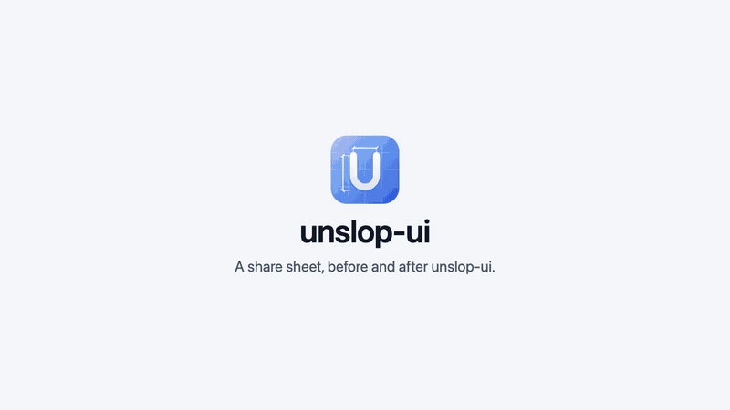
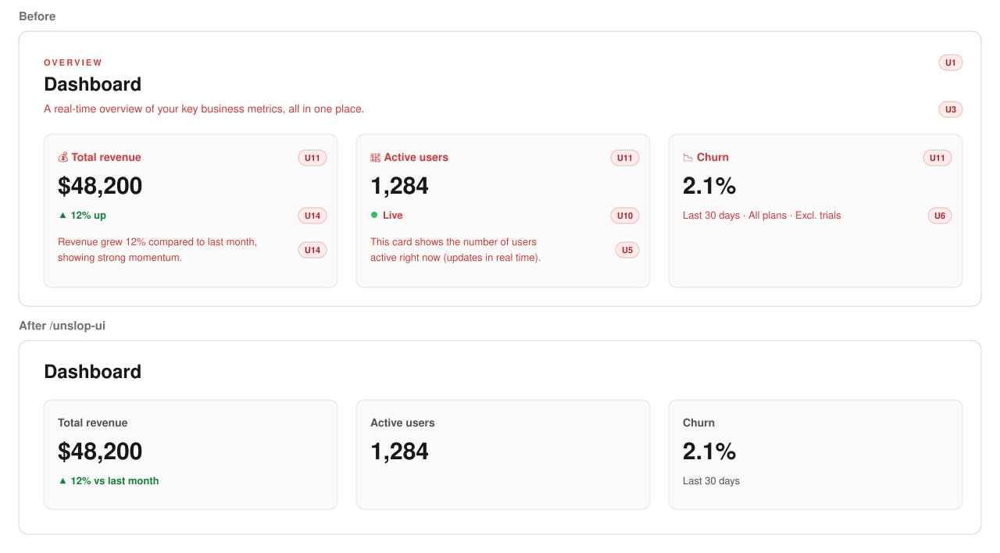
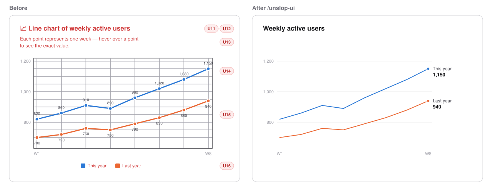
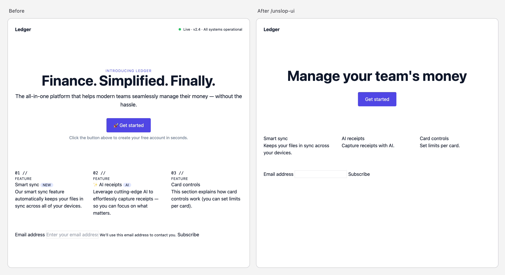
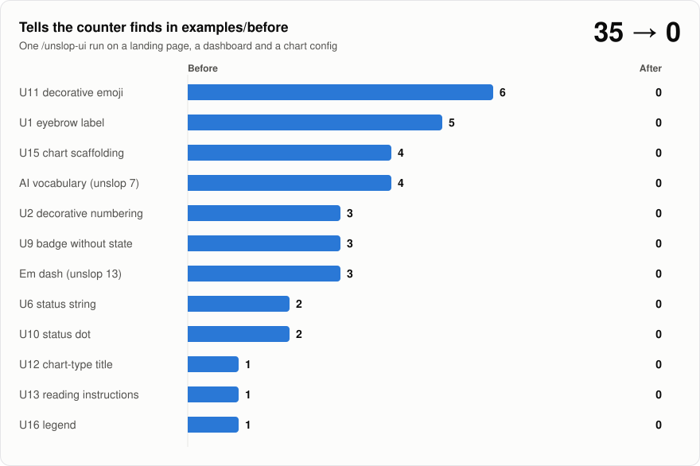

<p align="center">
  
</p>

<p align="center">An agent skill that strips the AI look out of interface and chart copy, and optionally its visual surface.</p>

<p align="center">
  <a href="https://github.com/felipebasurto/unslop-ui/actions/workflows/test.yml"></a>
  <a href="LICENSE"></a>
  <a href="https://agentskills.io"></a>
</p>

Agents decorate everything they build: a tiny uppercase label over every heading, `01 //` before each feature, a subtitle that repeats the title, a caption explaining the button you are looking at, a green "LIVE" dot wired to nothing. `unslop-ui` finds those patterns, removes them, and tells you what it cut and what it left for you to decide.

- **Subtractive.** It deletes first and writes little. It never adds a number, a speed or a feature the code doesn't show.
- **Safe by default.** Without `--surface` it touches only visible text and decoration, never logic, data, colors or layout. It keeps `aria-label`, `alt`, visible form labels and anything tied to real state.
- **Reports, not just edits.** Every run ends with a table of counts, the strings it rewrote, what it kept on purpose and the tasks it left for you.
- **Any language.** The counter never reads words, only structure, so it behaves the same on every language. The agent reads your copy in the language it is written in and makes the call.
- **Plan first, if you want.** `--plan` shows every cut and rewrite and waits for your OK before touching a file.

## Quick start

Install it:

```bash
npx skills add felipebasurto/unslop-ui -g
```

Then run it on a file, a folder or a component:

```
/unslop-ui src/pages/landing.tsx
/unslop-ui src/pages/dashboard.tsx --surface
/unslop-ui src/pages/landing.tsx --plan
```

With no argument it works on the files changed in the conversation. Codex uses `$unslop-ui`, and the Claude Code plugin uses `/unslop-ui:unslop-ui`.

The skill never triggers on its own, because cutting copy is a decision you should make. You have to call it.

## For agents

If a user sent you this repo and said "use this", do the following.

1. **Install the skill**, unless `unslop-ui` is already in your skills folder:

   ```bash
   npx skills add felipebasurto/unslop-ui -g
   ```

   Drop `-g` to install into the current project instead of your user folder. Requirements: Python 3.9 or newer, no packages.

2. **Pick the target.** Use the file, folder or component the user named. If they named none, use the files changed in this conversation. If there are none, ask.

3. **Run the skill.** In Claude Code, Cursor and any agent with slash commands or skill invocation, call `unslop-ui` with the target. Add `--surface` only if the user asked for visual cleanup (gradients, spacing, heavy weights, motion, edge bars). Add `--plan` if they want to see the changes before any file is touched.

4. **If you can't invoke skills**, open [`skills/unslop-ui/SKILL.md`](skills/unslop-ui/SKILL.md) and follow it by hand:
   - Treat the target as `$ARGUMENTS`.
   - Run `python3 scripts/load_unslop.py` from the skill's folder and apply the rules it prints. In Claude Code that line runs automatically. Elsewhere it doesn't.
   - Follow the procedure: count, read, verdict, edit, count again, review, report.

5. **End with the report** the skill defines: the counts table, then **Rewritten**, **Kept on purpose** and **Tasks**. The user needs the Rewritten list, because it is the only text you wrote.

Do not run it on a screen with nothing to cut. The verdict step exists so that a clean screen comes back untouched.

## What it removes


| Id | Pattern | Example |
|---|---|---|
| U1 | Eyebrow labels | `INTRODUCING LEDGER` above the H1, or a `● POLAR EXPEDITIONS` pill |
| U2 | Decorative numbering | `01 //`, `02 //` on features with no real order |
| U3 | Subtitle reflex | "Analytics" with "Understand your data better" under it, or a blurb under every menu item |
| U4 | Botsplaining | "Click the button above to get started" |
| U5 | Leaked design notes | "(updates in real time)", "This card shows..." |
| U6 | Status strings | `Live · v2.4 · Synced · Updated just now` |
| U7 | Labeling everything | Label, placeholder and helper text that all say "email" |
| U8 | Staccato slogans | "Finance. Simplified. Finally." |
| U9 | Badges without state | `NEW`, `AI`, `Beta` added for flavor |
| U10 | Status dots | `animate-pulse` dot next to static data |
| U11 | Decorative emojis and icons | `🚀 Get started`, an icon in a tinted square beside every menu item |
| U12 | Chart titles that name the chart | "Line chart of weekly active users" |
| U13 | Reading instructions | "Each point represents one week. Hover for details." |
| U14 | Saying it twice | A value on every point plus axis plus gridlines; `▲ 12% up` plus "Revenue grew 12%..." |
| U15 | Chart scaffolding | Frame box around the plot, dark or dense gridlines, thick axes, shadows, 3D |
| U16 | Legend instead of a label | A legend box when each line could carry its name at its end |
| U21 | Arrows on links and buttons | `Learn more →`, `Get started` followed by an arrow icon |
| U22 | One action, several names | "Get started", "Start now" and "Begin" for the same signup |
| U23 | Generic link and button names | "Click here", "Learn more", "Submit" |
| U24 | Equal stat cards (report only) | Three identical cards, a big number in each |
| U25 | States nobody handled (report only) | A list with no empty state, a form with nowhere to show an error |

U24 and U25 are never edited, because fixing them means adding structure. They come back as tasks. A `↗` that marks a link leaving the site, and an arrow that is the whole control (a Next button), are not U21 (`←` counts in a right-to-left script).

Everything that remains goes through the writing rules of [`/pstack:unslop`](https://github.com/cursor/plugins/tree/main/pstack) (em dashes, AI vocabulary, rule of three). If pstack is installed, `unslop-ui` reads its rules on every run and follows their updates. If not, it uses the condensed copy in [`references/unslop-fallback.md`](skills/unslop-ui/references/unslop-fallback.md). Either way it loads only the rules that apply to interface text.

### Surface rules (opt-in)

Add `--surface` and the skill also fixes five visual tells, each with a concrete replacement value from [`references/tokens.md`](skills/unslop-ui/references/tokens.md):

| Id | Pattern | Fix |
|---|---|---|
| U17 | Hue-to-hue gradients, gradient text, colored glows, blurred blobs | Solid neutral surface, hairline border, shadow no stronger than `0 1px 2px rgb(0 0 0 / 0.05)` |
| U18 | Off-scale spacing: `mt-[13px]`, `gap: 7px` | Nearest step of 4, 8, 12, 16, 20, 24, 32, 40, 48, 64 |
| U19 | `font-extrabold`, `font-black`, weights 800 and 900 | 500 or 600 |
| U20 | `transition-all`, `hover:scale-*` on cards, `animate-bounce`, a fade-up on every section as it scrolls in (`whileInView`, `data-aos`) | Named properties at 150ms ease-out, scroll-revealed content rendered in place |
| U26 | A colored 3px or thicker border on the left edge of a card (`border-l-4 border-indigo-500`) | 1px border all round, or a neutral tint. A bar on a real alert stays |

Without the flag these five never run. They replace a value with a better value. They don't change the palette, the type family or the layout. For that, see [Pairs well with](#pairs-well-with). If the project already has tokens (a Tailwind theme, CSS variables), the skill fixes toward those instead.

## Your own bans (taste file)

What counts as a tell depends on the team. Put a `.unslop-ui/taste.md` at the project root and `/unslop-ui` reads it on every run:

```markdown
## Bans

- Exclamation marks
- Uppercase text, not only eyebrows
- Middle dots between items
- The word "seamless"

## Keep

- The Beta badge in the header

## Off

- U11, our product names include emoji
```

Each ban is one more tell, fixed the same way as the others: delete first, write only from what the code shows. The first three have counter rules, **T1** exclamation marks, **T2** uppercase text anywhere and **T3** a middle dot standing alone, and `count_tells.py` counts them only when the file bans them. The agent finds any other ban by reading. Everything under **Keep** is left alone and listed in the report. A rule id under **Off** (`U11`, `unslop 13`, `T1`) is skipped entirely: the counter stops counting it and the agent does not apply it, which is how a team settles a style the rules disagree with. The guardrails still win: a ban on uppercase never removes an `aria-label` or a visible form label. Start from [`references/taste-example.md`](skills/unslop-ui/references/taste-example.md).

## How it behaves

Every run ends with a verdict: **heavy** (work through every rule), **light** (fix only what was found) or **none** (edit nothing, say so). A screen with nothing to cut is left alone.

- It keeps `aria-label`, `alt`, screen-reader text, and a visible label tied to every form field.
- Anything that reflects real state (a badge rendered from a prop, a real step order) stays, and the report says why.
- Text that comes from a translation file, props or a CMS is fixed at its source or reported, not hard-coded into the component.
- When a slogan has to become a sentence, the new text uses only what the page already says. Claims the code can't verify, such as "Trusted by 10,000+ teams" or a testimonial, are left in place and listed as tasks for you.
- When it deletes an element, it also deletes the empty wrapper, margin and unused import left behind.

### Plan first

`/unslop-ui src/pages/landing.tsx --plan` changes nothing. It counts, reads, gives the verdict and shows the plan: one line per cut, every rewrite as old and new, what it would keep and the tasks. Then it asks whether to apply it or change it, and edits exactly what you agreed to.

### The report

This one is from the run that produced `examples/after`, shortened:

| Rule | Before | After | Kept |
|---|---|---|---|
| U1 eyebrow | 5 | 0 | |
| U4 botsplaining | 5 | 0 | |
| U11 emoji | 6 | 0 | |
| unslop 13 em dash | 3 | 0 | |

**Rewritten**
```
"Finance. Simplified. Finally." → "Manage your team's money" (U8, from the cut hero line "manage their money")
"▲ 12% up" → "▲ 12% vs last month" (U14, the period came from the cut description)
"📈 Line chart of weekly active users" → "Weekly active users" (U12)
```

**Kept on purpose**
- `aria-label="Subscribe to newsletter"`: guardrail.
- The email label: it stays visible. I added `for="email"` and `id="email"` so it is tied to the input.

**Tasks**
- [ ] `Dashboard.tsx:15`  "12%" is hard-coded, not bound to data. Bind it to a prop or confirm it is a placeholder.
- [ ] `landing.html`  The hero now has no supporting line. If you want one, add a fact you can verify (price, free tier, integrations).

"Rewritten" lists every string the skill wrote, old and new, because that is the part you have to check. Deletions are in the diff. "Kept" is how many hits it left on purpose, so the count doesn't have to reach 0: the skill is told never to delete something legitimate to get there.

## Examples

The files in [`examples/before`](examples/before) were written to be full of tells. [`examples/after`](examples/after) is the unedited output of one `/unslop-ui` run in a fresh Claude Code session. The drawings show those files rendered with sample data, and each tell carries the id of the rule that removed it.

### A sheet, step by step

[](assets/video/unslop-ui-steps.mp4)

Five changes to one sheet, one at a time. [Watch the MP4](assets/video/unslop-ui-steps.mp4). The before and after live in [`examples/share-workspace`](examples/share-workspace).

### A dashboard



<details>
<summary>See the code change</summary>

```diff
-  <div>
-    <p className="... uppercase tracking-[0.2em] ...">Overview</p>
     <h1 className="text-2xl font-semibold">Dashboard</h1>
-    <p className="text-muted-foreground">A real-time overview of your key business metrics, all in one place.</p>
-  </div>

-  <CardTitle>💰 Total revenue</CardTitle>
+  <CardTitle>Total revenue</CardTitle>
-  <span className="text-green-600">▲ 12% up</span>
-  <CardDescription>Revenue grew 12% compared to last month, showing strong momentum.</CardDescription>
+  <span className="text-green-600">▲ 12% vs last month</span>

-  <span ...><span className="size-2 rounded-full bg-emerald-500 animate-ping" />Live</span>
-  <CardDescription>This card shows the number of users active right now (updates in real time).</CardDescription>

-  <span className="text-xs">Last 30 days · All plans · Excl. trials</span>
+  <span className="text-xs">Last 30 days</span>
```

Full files: [before](examples/before/Dashboard.tsx), [after](examples/after/Dashboard.tsx).

</details>

### A chart



<details>
<summary>See the code change</summary>

```diff
   plugins: {
-    title: { display: true, text: "📈 Line chart of weekly active users" },
-    subtitle: { display: true, text: "Each point represents one week — hover over a point to see the exact value." },
-    legend: { display: true, position: "bottom" },
-    datalabels: { display: true },
+    title: { display: true, text: "Weekly active users" },
+    legend: { display: false },
+    datalabels: {
+      display: (ctx) => ctx.dataIndex === ctx.dataset.data.length - 1,
+      formatter: (value, ctx) => `${ctx.dataset.label} ${value}`,
+      align: "right",
+    },
   },
   scales: {
-    x: { grid: { color: "#9ca3af", lineWidth: 2 }, border: { display: true, width: 2, color: "#111827" } },
-    y: { grid: { color: "#9ca3af", lineWidth: 2 }, border: { display: true, width: 2, color: "#111827" }, ticks: { stepSize: 25 } },
+    x: { grid: { color: "#e5e7eb", lineWidth: 1 }, border: { display: true, width: 1, color: "#e5e7eb" } },
+    y: { grid: { color: "#e5e7eb", lineWidth: 1 }, border: { display: true, width: 1, color: "#e5e7eb" }, ticks: { stepSize: 25 } },
   },
```

Full files: [before](examples/before/chart.js), [after](examples/after/chart.js).

</details>

### A landing page

The page from the annotated drawing above, rendered in a browser. Full files: [before](examples/before/landing.html), [after](examples/after/landing.html).



### By the numbers



The counter only sees the patterns a regex can find. The run also removes the ones that need reading, such as subtitles, botsplaining and slogans, and its report counts those separately.

## Automate it

### Keep tells out while the agent writes

`/unslop-ui` cleans a screen after the fact. Paste the block in [`agents-snippet.md`](skills/unslop-ui/references/agents-snippet.md) into your `AGENTS.md`, `CLAUDE.md` or a Cursor rule and the agent stops writing the tells to begin with. It is nine bullets.

### Catch tells as the agent edits (hook)

[`scripts/hook.py`](skills/unslop-ui/scripts/hook.py) runs after the agent writes a file, counts the tells in that one file and tells the agent what it found. It never edits, never blocks and exits silently on any error, so it is safe to leave on. It is opt-in: the skill itself still never runs on its own.

Claude Code, in `.claude/settings.json` (see [`examples/hooks`](examples/hooks)):

```json
{
  "hooks": {
    "PostToolUse": [
      {
        "matcher": "Edit|Write|MultiEdit",
        "hooks": [{ "type": "command", "command": "python3 ~/.claude/skills/unslop-ui/scripts/hook.py" }]
      }
    ]
  }
}
```

Cursor, in `.cursor/hooks.json`:

```json
{
  "version": 1,
  "hooks": {
    "postToolUse": [{ "command": "python3 ~/.cursor/skills/unslop-ui/scripts/hook.py", "matcher": "Write" }]
  }
}
```

The path is wherever the skill is installed. Set `UNSLOP_UI_SURFACE=1` to count the `--surface` rules as well. The hook reads `.unslop-ui/taste.md`, Off rules included. It ships with the skill, not with the Claude plugin, which has no scripts.

### In CI (GitHub Action)

```yaml
- uses: actions/checkout@v5
- uses: felipebasurto/unslop-ui@v1
  with:
    path: src
    max: "0"
```

It annotates the first few tells of each rule, writes the total to the job summary and fails above `max`. Leave `max` empty to only report. `surface: "true"` adds the surface rules, `taste` points at a taste file, and the `total` output holds the count.

## Install

With the [skills CLI](https://github.com/vercel-labs/skills), for Claude Code, Cursor, Codex and other agents:

```bash
npx skills add felipebasurto/unslop-ui -g
```

As a Claude Code plugin:

```bash
claude plugin marketplace add felipebasurto/unslop-ui
claude plugin install unslop-ui@unslop-ui
```

The plugin lives in [`plugins/unslop-ui`](plugins/unslop-ui). It is instructions only, with no scripts or shell commands, so it can pass the Claude plugin directory's checks. It counts tells with the Grep patterns in [`finding-tells.md`](plugins/unslop-ui/skills/unslop-ui/references/finding-tells.md) instead of `count_tells.py`. The rules in both builds are the same, and a test keeps them in step.

By hand:

```bash
git clone https://github.com/felipebasurto/unslop-ui
cp -R unslop-ui/skills/unslop-ui ~/.claude/skills/
```

Optional: install [pstack](https://github.com/cursor/plugins/tree/main/pstack) so `unslop-ui` reads the live unslop rules instead of the bundled copy.

### Compatibility

| Agent | Invoke with | Notes |
|---|---|---|
| Claude Code | `/unslop-ui` (plugin: `/unslop-ui:unslop-ui`) | Full support: loads unslop rules automatically, takes arguments. The plugin build counts with Grep, not the script |
| Cursor | `/unslop-ui` | Works. Run `scripts/load_unslop.py` yourself if the unslop rules don't appear |
| Codex | `$unslop-ui` | Works, explicit invocation only (`agents/openai.yaml`) |
| Any other agent | "Follow `skills/unslop-ui/SKILL.md` on `<target>`" | See [For agents](#for-agents) |

## The counter

`scripts/count_tells.py` is a regex counter for structure: eyebrow styling (U1), numbering (U2, skipped inside an `<ol>`), separators (U6), badge shapes (U9), status dots (U10), emojis and icon tiles (U11), em dashes, shadows, thick axis borders and gridlines and legends turned on in chart configs (U15, U16), arrow glyphs on links (U21) and the same link text pointing at different places (U23). With `--surface` it also counts U17 to U20 and U26, and a taste file in `.unslop-ui/taste.md` (or `--taste PATH`) adds T1 to T3. The skill runs it before and after editing. You can run it on its own, and `--max` makes it fail a CI job:

```bash
python3 skills/unslop-ui/scripts/count_tells.py src/
python3 skills/unslop-ui/scripts/count_tells.py --surface src/
python3 skills/unslop-ui/scripts/count_tells.py --max 0 src/   # exit 1 above 0
python3 skills/unslop-ui/scripts/count_tells.py --format github src/   # workflow annotations, for CI
```

It reads HTML, JSX, TSX, JS, TS, Vue, Svelte, Astro, Markdown and MDX, plus CSS, SCSS and Less for the styling rules, JSON for translation files, and Python for matplotlib and Plotly charts. It prints JSON with a count and up to five `file:line` locations per rule.

It never reads words, so it gives the same result on copy in any language and script: German, Japanese and Arabic screens with the same structure get the same counts. What a string means is left to the agent, which reads the copy in whatever language it is written: U3 to U5, U7, U8, U12, U13, U14, U22, U24, U25, filler words and generic link names. It is a heuristic. It skips what usually isn't a tell: comments, loading skeletons, uppercase table headers, a lone "—" in an empty cell, a single "·" between two facts, a badge shape on a button, numbers inside an ordered list. It still flags some legitimate cases, such as a badge that is wired to real data.

## Development

```bash
python3 -m unittest discover -s tests
```

The tests check that the counter finds every planted pattern in `examples/before`, finds none in `examples/after`, ignores comments and the legitimate look-alikes, that the loader picks the newest pstack install, keeps only the rules for interfaces, or falls back to the bundled copy, and that the hook and the Action script behave: silent on a clean file, fail open on bad input, exit codes right.

The counter can only reward deleting, so the behavior of the skill itself has its own check. [`evals/`](evals) holds small screens and what must be true after a run:

| Fixture | What it checks |
|---|---|
| `clean` | A screen with nothing to cut comes back byte-identical |
| `real-state` | A badge, a dot and numbering tied to real state or real order survive; the decorative ones go |
| `i18n` | Copy in a translation file is fixed there, not hard-coded into the component |
| `form` | Labels stay visible and tied to their inputs; a real constraint and an accessible name stay |
| `claims` | Slogans go without invented facts or numbers; unverifiable social proof is reported, not deleted |
| `nav-menu` | Decorative menu icons and per-item blurbs go; the destinations stay |
| `links` | Arrows after link text and generic names go, one action gets one name; an icon-only button and a `↗` keep theirs |
| `states` | Equal stat cards, a failure with no way out and a list with no empty state come back as tasks, with the file untouched |
| `plan` | With `--plan` nothing is edited and the plan is shown |
| `es`, `de`, `ja`, `ar` | The same rules on Spanish, German, Japanese (no case, no word spaces) and Arabic (right to left) copy |
| `surface-new` | With `--surface` a decorative edge bar and a scroll reveal go, including the hidden starting state; a bar on a real alert stays |
| `taste` | A taste file bans exclamation marks, keeps a badge and turns U11 off, and all three hold |

```bash
python3 evals/run.py                       # runs `claude -p` on every fixture, then checks
python3 evals/run.py form claims           # only these
python3 evals/run.py --agent 'cursor-agent -p --force' --skill-dest .cursor/skills/unslop-ui-eval   # Cursor's agent
python3 evals/run.py --no-install-skill --agent 'codex exec' --prompt '$unslop-ui .'   # another agent, using its installed skill
```

It copies the fixtures to a temporary folder, installs this checkout's skill into each copy under the name `unslop-ui-eval` (so the run tests your working tree, not whatever is installed on the machine), runs the agent there, and prints what failed with the path to the edited copies and each run's report. A fixture can set `args` (such as `--plan`) and `report_regex` for what the agent must say. Pass `--no-install-skill` to test an installed skill instead. It needs an agent CLI and spends tokens, so it is not part of CI. Run it after changing `SKILL.md`.

### Incidents

Every false positive or missed tell that gets fixed becomes a file in [`evals/incidents`](evals/incidents): the report, the counter output it must keep giving, and a phrase that must stay written in a rule file, so a later edit can't quietly undo the fix. `python3 evals/run.py --incidents` replays them with no agent and no tokens, and the test suite runs them too.

```json
{
  "id": "button-new-is-not-a-badge",
  "report": "<Button>New</Button> was counted as a U9 badge, but it is an action.",
  "rule": { "file": "skills/unslop-ui/SKILL.md", "phrase": "Keep a badge only if it reflects data the app actually tracks" },
  "counter": { "suffix": ".tsx", "source": "<Button>New</Button>\n", "expect": { "U9 badge word": 0 } }
}
```

Found one? Open a [false positive](https://github.com/felipebasurto/unslop-ui/issues/new?template=false-positive.yml) or a [missed tell](https://github.com/felipebasurto/unslop-ui/issues/new?template=missed-tell.yml) issue with the smallest snippet that shows it.

## Versioning

From 1.0 these are stable, and a change to any of them is a 2.0:

- **Rule ids.** U1 to U26 and T1 to T3 keep their meaning and are never reused. New rules take the next number.
- **Counter output.** The JSON is `{"<id> <name>": {"count", "examples"}, ..., "total"}`, the flags are `--surface`, `--max`, `--taste` and `--format`, and the exit codes are 0, 1 above `--max` and 2 for a missing path. A rule gaining patterns, so a count can rise, is not a breaking change.
- **Taste file.** The `.unslop-ui/taste.md` location and its three sections, Bans, Keep and Off.
- **Invocation.** `--surface` and `--plan`, and a skill that never runs on its own.

## Pairs well with

[tufte-claude-skill](https://github.com/aref-vc/tufte-claude-skill) builds charts from Edward Tufte's principles: chart choice, graphical integrity, small multiples. `unslop-ui` doesn't redesign charts. It borrows the subtractive half of those ideas (one encoding per quantity, faint scaffolding, direct labels over legends) as U14 to U16, so you can build with the Tufte skill and clean up any interface with this one.

[unslop](https://github.com/heydamir/unslop) by Damir Sokolovsky ([@heydamir](https://x.com/heydamir)) covers the whole screen instead of the copy: it writes a short design direction first, then works through spacing, color, icons, copy, type, layout, details, visuals and motion, with starting tokens for each. If a dashboard needs a redesign and not only a cleanup, run it first, then run `unslop-ui` as the final copy and chart pass. `unslop-ui` stays subtractive on purpose: it won't pick a direction, a palette or a type family for you.

[design.how](https://github.com/arla6ka/design.how) by [@arla6ka](https://github.com/arla6ka) goes the other way: skills to build a design system, move an app onto it and review a screen, plus four ready systems. Run it when the whole app needs structure, then `unslop-ui` on the copy. Its taste file and its incident evals inspired the two features above.

## Credits

The taste file and the incident evals follow the shape of [design.how](https://github.com/arla6ka/design.how) (MIT): its `taste.md` bans and its `evals/incidents` cases. The `--surface` rules, the verdict step and the report-as-tasks list were suggested by user feedback after comparing this skill with [unslop](https://github.com/heydamir/unslop) (CC BY 4.0). The values in `references/tokens.md` are written for this skill, using common practice (a 4px grid, 4.5:1 contrast, hairline borders).

The unslop rules are by [Lauren Tan](https://github.com/poteto), from [pstack](https://github.com/cursor/plugins/tree/main/pstack) (MIT). U14 to U16 follow Edward Tufte's data-ink and chartjunk principles. The other UI patterns come from what designers and developers keep pointing out about AI-built interfaces in 2026.

## License

[MIT](LICENSE)
