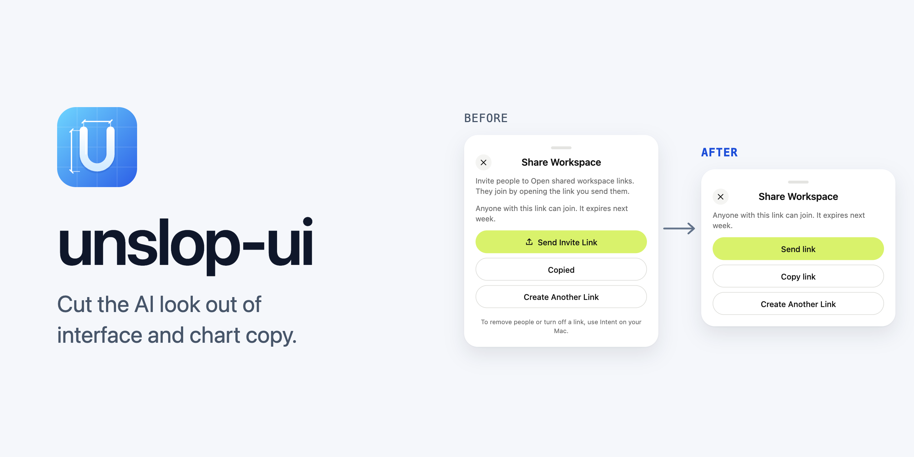
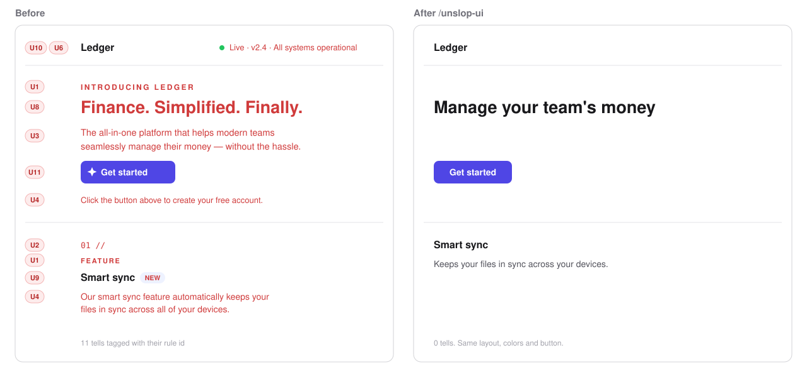

<p align="center">
  
</p>

<p align="center">An agent skill that strips the AI look out of interface and chart copy.</p>

<p align="center"><a href="https://skills.sh/felipebasurto/unslop-ui"></a></p>

Agents decorate everything they build: a tiny uppercase label over every heading, `01 //` before each feature, a subtitle that repeats the title, a caption explaining the button you are looking at, a green "LIVE" dot wired to nothing. `unslop-ui` removes those patterns and tells you what it cut and what it left for you to decide.

## Use it

Paste the link to your agent with what you want cleaned:

```
Clean up the copy in src/pages/landing.tsx with https://github.com/felipebasurto/unslop-ui
```

That's all. Add "fix the visual surface too" for gradients, edge accent bars, spacing, weights and motion, or "show me the plan first" to approve the changes before any file is touched. You can combine both.

## For agents

If a user sent you this repo, read [`skills/unslop-ui/SKILL.md`](https://raw.githubusercontent.com/felipebasurto/unslop-ui/main/skills/unslop-ui/SKILL.md) and follow it on the target they named. If a rule sends you to a file under `references/`, read it next to `SKILL.md` at the same raw base URL. If they named no target, use the files changed in this conversation, or ask. Nothing needs to be installed or run. End with the report the skill defines.

## What it removes



| Id | Pattern | Example |
|---|---|---|
| U1 | Eyebrow labels | `INTRODUCING LEDGER` above the H1, or a `● POLAR EXPEDITIONS` pill |
| U2 | Decorative numbering | `01 //`, `02 //` on features with no real order |
| U3 | Subtitle reflex | "Analytics" with "Understand your data better" under it, or "No credit card required" under a button |
| U4 | Botsplaining | "Click the button above to get started" |
| U5 | Leaked design notes | "(updates in real time)", "(powered by AI)" |
| U6 | Status strings | `Live · v2.4 · Synced · Updated just now` |
| U7 | Labeling everything | Label, placeholder and helper text that all say "email" |
| U8 | Staccato slogans | "Finance. Simplified. Finally." |
| U9 | Badges without state | `NEW`, `AI`, `Beta` added for flavor |
| U10 | Status dots | `animate-pulse` dot next to static data |
| U11 | Decorative emojis and icons | `🚀 Get started`, an icon in a tinted square beside every item |
| U12 | Chart titles that name the chart | "Line chart of weekly active users" |
| U13 | Reading instructions | "Each point represents one week. Hover for details." |
| U14 | Saying it twice | A value on every point plus axis plus gridlines, or stacked captions restating a KPI |
| U15 | Chart scaffolding | Frame box, dark gridlines, thick axes, shadows, 3D |
| U16 | Legend instead of a label | A legend box when each line could carry its name |
| U21 | Arrows on links and buttons | `Learn more →` |
| U22 | Generic link and button names | "Click here", "Learn more", "Submit" |
| U23 | Equal stat cards (report only) | Three identical cards, a big number in each. It comes back as a task, the layout is yours |

With the visual surface (`--surface`):

| Id | Pattern | Fix |
|---|---|---|
| U17 | Hue-to-hue gradients, gradient text, colored glows | Solid neutral surface, hairline border |
| U18 | Off-scale spacing: `mt-[13px]`, `gap: 7px` | Nearest step of 4, 8, 12, 16, 20, 24, 32, 40, 48, 64 |
| U19 | `font-extrabold`, `font-black` | 500 or 600 |
| U20 | `transition-all`, `hover:scale-*` on cards, fade-up on scroll, numbers that count up on load | Named properties at 150ms, content and numbers shown in place |
| U24 | A colored bar on the left edge of a card | 1px border all round. A bar on a real alert stays |

Every string it keeps also goes through the writing rules of unslop by Lauren Tan: no em dashes, no AI vocabulary, no bold lead-ins that repeat their line, no abstract jargon, no forced rule of three.

## What it won't do

- Invent a number, a speed or a feature the code doesn't show. It deletes first and writes little.
- Touch logic, data, colors or layout. Surface fixes replace a value with a better one, they don't redesign.
- Remove `aria-label`, `alt`, visible form labels, links, buttons or anything tied to real state.
- Edit a screen with nothing to cut. A clean screen comes back untouched.
- Delete claims it can't verify ("Trusted by 10,000+ teams"). Those come back as tasks.

## What you get back

The edited files and a short report: the verdict, a table per rule, every string it rewrote (the part you have to check), what it kept on purpose and the tasks it left for you.

| Rule | Found | Fixed | Kept |
|---|---|---|---|
| U1 eyebrow | 5 | 5 | |
| U4 botsplaining | 5 | 5 | |
| U11 emoji | 6 | 6 | |
| unslop 13 em dash | 3 | 3 | |

```
"Finance. Simplified. Finally." → "Manage your team's money" (U8)
"📈 Line chart of weekly active users" → "Weekly active users" (U12)
```

## Examples

The files in [`examples/before`](examples/before) were written to be full of tells. [`examples/after`](examples/after) is the unedited output of one run.


## Your own bans (taste file)

Put a `.unslop-ui/taste.md` at the project root and the skill reads it on every run:

```markdown
## Bans

- Exclamation marks
- The word "seamless"

## Keep

- The Beta badge in the header

## Off

- U11, our product names include emoji
```

Each ban is one more tell, fixed the same way as the others. Everything under **Keep** is left alone. A rule id under **Off** is skipped. The guardrails still win: a ban on uppercase never removes an `aria-label`. Full format in [`taste.md`](skills/unslop-ui/references/taste.md).

## Install (optional)

You don't need to install anything to use it. If you use it often, install it: it follows the [Agent Skills](https://agentskills.io) standard, so it works in any agent that [supports it](https://agentskills.io/clients) (Claude Code, Codex, Cursor, Copilot, Gemini CLI and more). Installed, your agent also runs it on its own after it builds or restyles a screen.

```bash
npx skills add felipebasurto/unslop-ui -g
```

Then `/unslop-ui src/pages/landing.tsx`, with `--surface` or `--plan` if you want them. As a Claude Code plugin:

```bash
claude plugin marketplace add felipebasurto/unslop-ui
claude plugin install unslop-ui@unslop-ui
```

The plugin runs as `/unslop-ui:unslop-ui` and uses the same `SKILL.md`.

### Keep tells out while the agent writes

If you build with agents every day, paste this into your `AGENTS.md`, `CLAUDE.md` or a Cursor rule, and most tells never get written:

```markdown
## Interface copy

When you write or edit interface text, charts or screens in this project:

- A heading says what the section is. No eyebrow label above it, no `01 //` numbering unless the order is real, no subtitle that repeats the heading, and no boilerplate footnote under a CTA or form ("No credit card required", "No spam").
- Never describe what is already visible: no "Click the button below", "This chart shows", "(updates in real time)".
- Badges, status dots and "Live" labels render from real state, or they are not there.
- No decorative emoji, and no icon in a tinted square beside every item.
- Links and buttons: no `→` or arrow icon after the text, and no "Click here", "Learn more" or "Submit". Name the destination or the result.
- Charts and KPIs: the title names the measure, not the chart type. No reading instructions, no legend where a direct label fits, hairline gridlines, and at most one line of context on a KPI card.
- Errors and empty states say what happened and what to do next, without "Oops" or an apology.
- No filler words: "seamless", "robust", "empower", "effortlessly". No em dashes: end the sentence or use a comma. Never invent a number, a customer count or a testimonial.
```

## Development

[`evals/`](evals) holds small screens and what must be true after a run: a clean screen stays byte-identical, real state survives, translation files are fixed at the source, form labels stay, nothing gets invented, and the same rules hold in Spanish, German, Japanese and Arabic.

```bash
python3 evals/run.py                # runs `claude -p` on every fixture, then checks
python3 evals/run.py form claims    # only these
python3 evals/run.py --triggers     # checks description triggering and near-misses
```

It installs this checkout's skill into a copy of each fixture, so a run tests your working tree. It spends tokens. Run it after changing `SKILL.md`.

Found a bad cut or a missed tell? Open a [false positive](https://github.com/felipebasurto/unslop-ui/issues/new?template=false-positive.yml) or a [missed tell](https://github.com/felipebasurto/unslop-ui/issues/new?template=missed-tell.yml) issue with the smallest snippet that shows it.

## Credits

The writing rules are by [Lauren Tan](https://github.com/poteto), from the unslop skill in [pstack](https://github.com/cursor/plugins/tree/main/pstack) (MIT). U14 to U16 follow Edward Tufte's data-ink and chartjunk principles. The motion checks in U20 borrow from [remove-animations](https://github.com/emilkowalski/skills) by Emil Kowalski. The surface rules and the verdict step came from user feedback after comparing this skill with [unslop](https://github.com/heydamir/unslop) by Damir Sokolovsky.

## License

[MIT](LICENSE)
