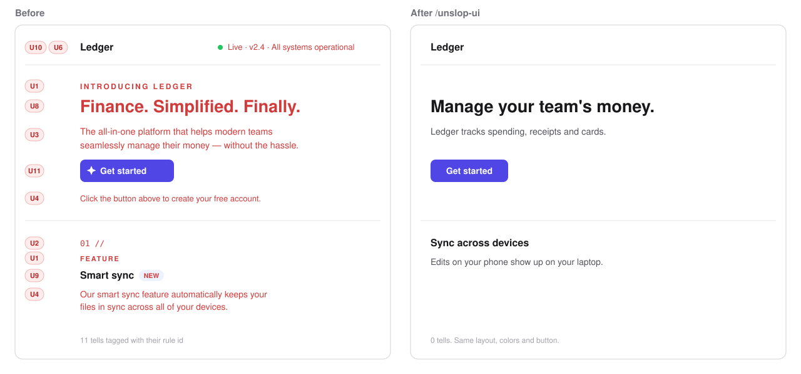
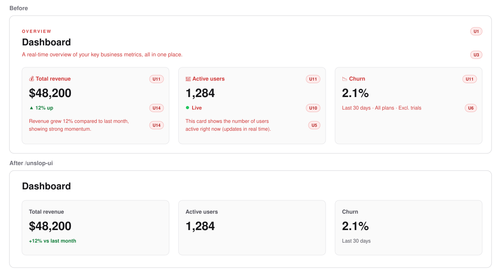
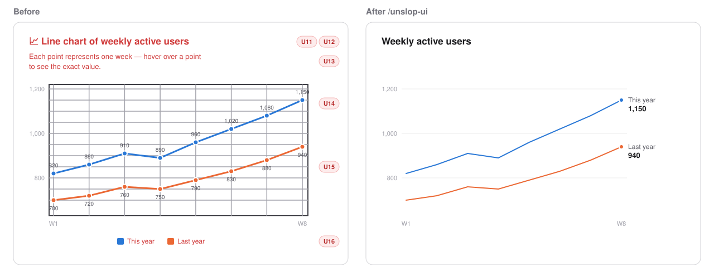
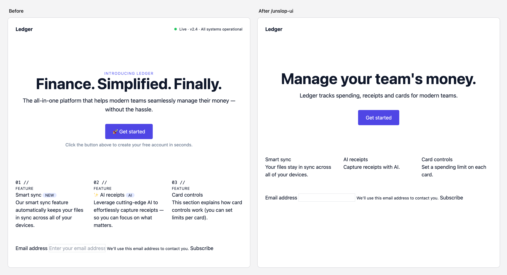
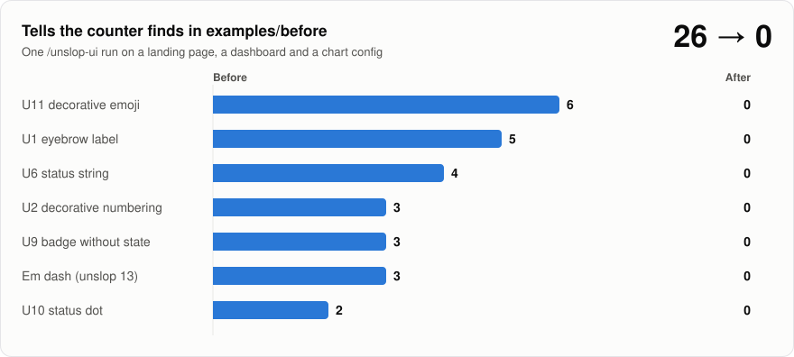

<h1 align="center">unslop-ui</h1>

<p align="center">An agent skill that strips the AI look out of interface and chart copy.</p>

<p align="center">
  <a href="https://github.com/felipebasurto/unslop-ui/actions/workflows/test.yml"></a>
  <a href="LICENSE"></a>
  <a href="https://agentskills.io"></a>
</p>



Agents decorate everything they build: a tiny uppercase label over every heading, `01 //` before each feature, a subtitle that repeats the title, a caption explaining the button you are looking at, a green "LIVE" dot wired to nothing. `unslop-ui` finds those patterns, removes them, and tells you what it cut and what it left for you to decide.

It is the interface companion to [`/pstack:unslop`](https://github.com/cursor/plugins/tree/main/pstack), which cleans prose. `unslop-ui` loads unslop's rules when it runs and applies them to every string it keeps.

## What it removes

| Id | Pattern | Example |
|---|---|---|
| U1 | Eyebrow labels | `INTRODUCING LEDGER` above the H1 |
| U2 | Decorative numbering | `01 //`, `02 //` on features with no real order |
| U3 | Subtitle reflex | "Analytics" with "Understand your data better" under it |
| U4 | Botsplaining | "Click the button above to get started" |
| U5 | Leaked design notes | "(updates in real time)", "This card shows..." |
| U6 | Status strings | `Live · v2.4 · Synced · Updated just now` |
| U7 | Labeling everything | Label, placeholder and helper text that all say "email" |
| U8 | Staccato slogans | "Finance. Simplified. Finally." |
| U9 | Badges without state | `NEW`, `AI`, `Beta` added for flavor |
| U10 | Status dots | `animate-pulse` dot next to static data |
| U11 | Decorative emojis | `🚀 Get started`, `💰 Revenue` |
| U12 | Chart titles that name the chart | "Line chart of weekly active users" |
| U13 | Reading instructions | "Each point represents one week. Hover for details." |
| U14 | Saying it twice | A value on every point plus axis plus gridlines; `▲ 12% up` plus "Revenue grew 12%..." |
| U15 | Chart scaffolding | Frame box around the plot, dark or dense gridlines, thick axes, shadows, 3D |
| U16 | Legend instead of a label | A legend box when each line could carry its name at its end |

It leaves logic, data, colors and layout alone. It keeps `aria-label`, `alt` and screen-reader text, and moves a cut label into `aria-label` when it was the only accessible name. Anything that reflects real state (a live connection, a real step order) stays, and the report says why.

## Examples

All three come from [`examples/`](examples): the files in `before/` were written to be full of tells, and `after/` is the unedited output of one `/unslop-ui` run in a fresh Claude Code session. The drawings show those files rendered with sample data, and each tell carries the id of the rule that removed it.

### A dashboard



<details>
<summary>See the code change</summary>

```diff
-  <p className="... uppercase tracking-[0.2em] ...">Overview</p>
   <h1 className="text-2xl font-semibold">Dashboard</h1>
-  <p className="text-muted-foreground">A real-time overview of your key business metrics, all in one place.</p>

-  <CardTitle>💰 Total revenue</CardTitle>
+  <CardTitle>Total revenue</CardTitle>
-  <span className="text-green-600">▲ 12% up</span>
-  <CardDescription>Revenue grew 12% compared to last month, showing strong momentum.</CardDescription>
+  <span className="text-green-600">+12% vs last month</span>

-  <span ...><span className="size-2 rounded-full bg-emerald-500 animate-ping" />Live</span>
-  <CardDescription>This card shows the number of users active right now (updates in real time).</CardDescription>

-  <span className="text-xs">Last 30 days · All plans · Excl. trials</span>
+  <span className="text-xs">Last 30 days</span>
```

Full files: [before](examples/before/Dashboard.tsx), [after](examples/after/Dashboard.tsx).

</details>

### A chart



<details>
<summary>See the code change</summary>

```diff
   plugins: {
-    title: { display: true, text: "📈 Line chart of weekly active users" },
-    subtitle: { display: true, text: "Each point represents one week — hover over a point to see the exact value." },
-    legend: { display: true, position: "bottom" },
-    datalabels: { display: true },
+    title: { display: true, text: "Weekly active users" },
+    legend: { display: false },
+    datalabels: {
+      display: (ctx) => ctx.dataIndex === ctx.dataset.data.length - 1,
+      formatter: (value, ctx) => `${ctx.dataset.label} ${value}`,
+      align: "right",
+      offset: 8,
+    },
   },
   scales: {
-    x: { grid: { color: "#9ca3af", lineWidth: 2 }, border: { display: true, width: 2, color: "#111827" } },
-    y: { grid: { color: "#9ca3af", lineWidth: 2 }, border: { display: true, width: 2, color: "#111827" }, ticks: { stepSize: 25 } },
+    x: { grid: { color: "#e5e7eb", lineWidth: 1 }, border: { display: true, width: 1, color: "#d1d5db" } },
+    y: { grid: { color: "#e5e7eb", lineWidth: 1 }, border: { display: false }, ticks: { stepSize: 25 } },
   },
```

Full files: [before](examples/before/chart.js), [after](examples/after/chart.js).

</details>

### A landing page

The page from the drawing at the top, rendered in a browser. Full files: [before](examples/before/landing.html), [after](examples/after/landing.html).



### By the numbers



The counter only sees the patterns a regex can find. The run also removes the ones that need reading, such as subtitles, botsplaining, slogans and chart titles, and its report counts those separately.

## Install

With the [skills CLI](https://github.com/vercel-labs/skills), for Claude Code, Cursor, Codex and other agents:

```bash
npx skills add felipebasurto/unslop-ui -g
```

As a Claude Code plugin:

```bash
claude plugin marketplace add felipebasurto/unslop-ui
```

```bash
claude plugin install unslop-ui@unslop-ui
```

By hand:

```bash
git clone https://github.com/felipebasurto/unslop-ui && cp -R unslop-ui/skills/unslop-ui ~/.claude/skills/
```

For the full effect, install [pstack](https://github.com/cursor/plugins/tree/main/pstack) too. Without it, `unslop-ui` falls back to a short list of prose rules.

## Use

```
/unslop-ui src/pages/landing.tsx
```

Pass a file, a folder or a component name. With no argument it works on the files changed in the conversation. As a Claude Code plugin the command is `/unslop-ui:unslop-ui`. In Codex, type `$unslop-ui`.

The skill only runs when you call it. It never triggers on its own, because cutting copy is a decision you should make.

Each run ends with a report:

| Rule | Before | After |
|---|---|---|
| U1 eyebrow | 5 | 0 |
| U2 decorative numbering | 3 | 0 |
| unslop 13 em dash | 3 | 0 |

followed by what it kept on purpose and what needs your decision, such as a status dot that might be wired to real data.

## The counter

`scripts/count_tells.py` is a regex counter for the patterns that can be found mechanically (U1, U2, U6, U9, U10, U11, em dashes, and the code forms of U15 and U16: shadows, thick axis borders and gridlines, legends turned on). The skill runs it before and after editing. You can run it on its own, in CI for example:

```bash
python3 skills/unslop-ui/scripts/count_tells.py src/
```

It prints JSON with a count and up to five `file:line` locations per rule. It is a heuristic: it catches candidates, misses the patterns that need reading (U3 to U5, U7, U8, U12 to U14) and flags some legitimate cases.

## Compatibility

| Agent | Status |
|---|---|
| Claude Code | Full support: loads unslop rules automatically, takes arguments |
| Cursor | Works. Run `scripts/load_unslop.py` yourself if the unslop rules don't appear |
| Codex | Works, explicit invocation only (`agents/openai.yaml`) |

The counter needs Python 3.9 or newer and no packages.

## Development

```bash
python3 -m unittest discover -s tests
```

The tests check that the counter finds every planted pattern in `examples/before`, finds none in `examples/after`, ignores code comments, and that the loader picks the newest pstack install or falls back cleanly.

## Pairs well with

[tufte-claude-skill](https://github.com/aref-vc/tufte-claude-skill) builds charts from Edward Tufte's principles: chart choice, graphical integrity, small multiples. `unslop-ui` doesn't redesign charts. It borrows the subtractive half of those ideas (one encoding per quantity, faint scaffolding, direct labels over legends) as U14 to U16, so you can build with the Tufte skill and clean up any interface with this one.

## Credits

The unslop rules are by [Lauren Tan](https://github.com/poteto), from [pstack](https://github.com/cursor/plugins/tree/main/pstack) (MIT). U14 to U16 follow Edward Tufte's data-ink and chartjunk principles. The other UI patterns come from what designers and developers keep pointing out about AI-built interfaces in 2026.

## License

[MIT](LICENSE)
